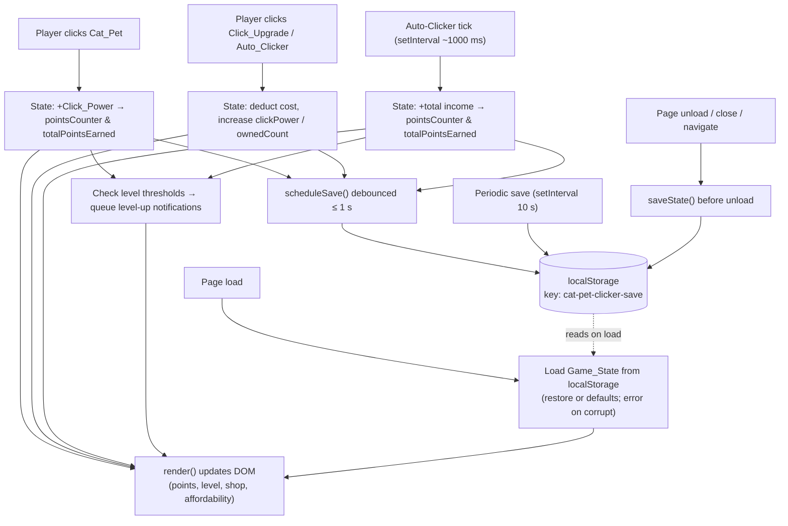

# Design Document: Cat Pet Clicker

## Overview

The Cat Pet Clicker is a single-page browser game with no build step and no backend. The player clicks a cat pet to earn points, spends points on upgrades that increase points per click, and buys auto-clickers that generate passive income once per second. A level-progression system derives the player's level from total points earned, progress persists to `localStorage` across reloads, and a reset feature lets the player start over.

This document describes the file layout, the logical modules inside the single JavaScript file, the persisted data model, the key design decisions that satisfy the acceptance criteria, the rendering approach, a data-flow diagram, and a mapping from design components back to requirements.

### Goals
- Run entirely in the browser from a single HTML file plus one CSS and one JS file, with Tailwind loaded via CDN.
- Implement all nine requirements with vanilla JavaScript and no framework.
- Persist a well-defined `Game_State` object to `localStorage` and restore it deterministically, including corruption recovery.
- Provide clear, satisfying visual feedback (floating points indicator, scale animation, level-up notifications).
- Keep the code modular and readable inside one JS file so the mechanics are easy to tune.

### Non-Goals
- No multiplayer, no backend, no analytics, no build tooling.
- No framework (React, Vue, etc.) and no bundler.
- No external image assets are required; a styled/emoji cat is used as a placeholder.

## Architecture

All game files live in the workspace root so the HTML file is openable directly in a browser with no server and no build step.

```
<workspace root>/
├── index.html      # Single HTML page: structure, Tailwind CDN script, links CSS + JS
├── styles.css      # Vanilla CSS: cat pet, animations (scale, float), level-up banner, layout polish
└── game.js         # Vanilla JavaScript: all game logic (state, render, save, loop, events, definitions)
```

### `index.html`
- Contains the page markup: header (points counter, total earned, level), the cat pet element, the upgrade shop, the reset button, the level-up notification area, and an error message container.
- Loads Tailwind CSS via a CDN `<script>` tag in `<head>` (Requirement 8.2).
- Links `styles.css` via a `<link rel="stylesheet">` tag.
- Loads `game.js` via a `<script src="game.js" defer></script>` tag.
- No module bundling; plain `<script>` inclusion.

### `styles.css`
- Defines the cat pet base styling, the scale "pop" keyframe animation, the floating points indicator animation, the level-up banner styling, the shop item styling, and any layout details not handled by Tailwind utilities.

### `game.js`
- All game logic. Organized into clearly delimited logical modules (sections) described below.

### Logical Modules

The single JS file is organized into the following named sections, each with a comment banner. They are plain functions and objects (no classes required), but the grouping keeps concerns separated.

1. **Upgrade Definitions** — Static definitions of `Click_Upgrade` and `Auto_Clicker` types (id, name, baseCost, effect/incomeRate). These are code constants, never persisted directly.
2. **Default State** — The `DEFAULT_STATE` object used for new games and corruption recovery.
3. **State Management** — The live `state` object plus pure helper functions: `addPoints`, `deductPoints`, `clampToZero`, `purchaseClickUpgrade`, `purchaseAutoClicker`, `checkLevelUp`.
4. **Save System** — `saveState`, `loadState`, `debouncedSave`, schema validation, corruption handling, auto-save interval, and `beforeunload` save.
5. **Game Loop** — The auto-clicker `setInterval` tick that adds passive income once per second.
6. **Rendering** — `render()` reads `state` and updates the DOM (points, level, shop costs/affordability, owned counts). Called after every state change.
7. **Event Handlers** — Click handler for the cat pet, click handlers for upgrade buttons, reset button + confirmation dialog, `DOMContentLoaded`/`load` bootstrap.
8. **Visual Feedback** — `spawnPointsIndicator(x, y)` and `triggerCatScale()` helpers; level-up notification queue.

### Design Decisions

#### Auto-Clicker Tick

A single `setInterval` drives passive income:

```js
const AUTO_TICK_MS = 1000; // within the 900–1100 ms tolerance
setInterval(autoTick, AUTO_TICK_MS);
```

`autoTick` computes total income as the sum across all Auto_Clicker types of `incomeRate * ownedCount`, then adds it to both `pointsCounter` and `totalPointsEarned` (Requirements 4.2 and 4.3). It then checks for level-ups and calls `render()`. A 1000 ms interval keeps consecutive additions between 900 and 1100 ms in practice (timers may drift slightly but stay within tolerance). The tick is started once on load and stopped on unload.

```js
function autoTick() {
  const income = totalAutoIncome();
  addPoints(income);            // updates pointsCounter + totalPointsEarned
  checkLevelUp();               // queues level-up notifications if thresholds crossed
  render();
  scheduleSave();               // debounced save within 1 s
}

function totalAutoIncome() {
  let sum = 0;
  for (const def of AUTO_CLICKERS) {
    const owned = state.autoClickers[def.id];
    sum += def.incomeRate * owned.ownedCount;
  }
  return sum;
}
```

#### Save / Restore and Corruption Handling

**Save** writes the `Game_State` as JSON:

```js
const SAVE_KEY = "cat-pet-clicker-save";
function saveState() {
  localStorage.setItem(SAVE_KEY, JSON.stringify(state));
}
```

**Load** reads and validates on page load (Requirement 5.2):

```js
function loadState() {
  const raw = localStorage.getItem(SAVE_KEY);
  if (raw === null) return structuredClone(DEFAULT_STATE); // 5.3: no save -> defaults
  try {
    const parsed = JSON.parse(raw);
    if (!isValidGameState(parsed)) {
      throw new Error("invalid schema");
    }
    return mergeWithDefaults(parsed);
  } catch (err) {
    showErrorMessage("Your saved data could not be loaded. A new game has been started.");
    return structuredClone(DEFAULT_STATE);              // 5.4: corrupt -> defaults + error message
  }
}
```

`isValidGameState` performs schema validation:
- `pointsCounter`, `clickPower`, `totalPointsEarned`, `playerLevel` are finite numbers; `pointsCounter` ≥ 0, `clickPower` ≥ 1, `totalPointsEarned` ≥ 0, `playerLevel` ≥ 1.
- `clickUpgrades` and `autoClickers` are objects whose keys match the known upgrade ids, with `ownedCount` (non-negative integer) and `currentCost` (positive number) for each.
- Any unknown/extra fields, missing fields, or wrong types cause validation to fail, triggering the corrupt-data path.

`mergeWithDefaults` fills in any missing upgrade entries from `DEFAULT_STATE` so forward-compatible loads are robust, while still rejecting structurally invalid data.

The error message is shown in a dedicated, dismissible element in the page header and remains until the player dismisses it or starts interacting.

#### Debounced Save (within 1 second of a change)

Requirement 5.6 requires a save within 1 second of a state change. A debounce timer satisfies this without flooding `localStorage` on rapid clicks:

```js
let saveTimer = null;
function scheduleSave() {
  if (saveTimer) clearTimeout(saveTimer);
  saveTimer = setTimeout(saveState, 500); // well within the 1 s requirement
}
```

`scheduleSave()` is called after every state mutation (click, upgrade purchase, auto-tick, level-up). If changes happen faster than 500 ms, the timer resets, so the latest state is always written within 1 s of the last change.

Two additional save triggers satisfy the remaining criteria:
- **Periodic (Requirement 5.5):** `setInterval(saveState, 10000)` — every 10 seconds while open.
- **On unload (Requirement 5.7):** `window.addEventListener("beforeunload", saveState)` — writes the current state before the page unloads. A final synchronous `saveState()` call in the handler covers reload/close/navigation.

#### Non-Negativity Guard

Requirement 2.4 (and the implicit guard for spending) requires `pointsCounter` never to go below zero. A single helper centralizes this:

```js
function clampToZero(value) {
  return Math.max(0, value);
}
```

Every mutation that subtracts from `pointsCounter` routes through `deductPoints`, which clamps the result:

```js
function deductPoints(amount) {
  state.pointsCounter = clampToZero(state.pointsCounter - amount);
}
```

Purchase handlers only deduct when `pointsCounter >= currentCost`, so the clamp is a safety net rather than the primary control, but it guarantees the invariant even if a calculation would otherwise produce a negative value.

#### Level-Up Notification Queue

Level thresholds: reaching level N requires `totalPointsEarned >= 100 * N^2` (Requirement 6.2). So the threshold to advance from the current level `L` to `L+1` is `100 * (L+1)^2`.

```js
function nextLevelThreshold(level) {
  return 100 * (level + 1) * (level + 1);
}
```

When points are added, `checkLevelUp` loops while the next threshold is met, incrementing the level and queueing one notification per crossed threshold (Requirement 6.4):

```js
function checkLevelUp() {
  let crossed = 0;
  while (state.totalPointsEarned >= nextLevelThreshold(state.playerLevel)) {
    state.playerLevel += 1;
    crossed += 1;
  }
  for (let i = 0; i < crossed; i++) {
    enqueueLevelUpNotification(state.playerLevel - crossed + i + 1);
  }
}
```

Notifications are shown sequentially from a small queue so that each remains visible for exactly 2 seconds (Requirement 6.3, 6.4). Overlapping them would make individual durations ambiguous; a queue guarantees each one is displayed for exactly 2 seconds:

```js
const notificationQueue = [];
let notificationShowing = false;
function enqueueLevelUpNotification(level) {
  notificationQueue.push(level);
  if (!notificationShowing) showNextNotification();
}
function showNextNotification() {
  if (notificationQueue.length === 0) { notificationShowing = false; return; }
  notificationShowing = true;
  const level = notificationQueue.shift();
  const banner = showBanner(`Level Up! You reached Level ${level}`);
  setTimeout(() => {
    hideBanner(banner);
    showNextNotification();
  }, 2000); // exactly 2 seconds
}
```

#### Points Indicator

On each cat click, a DOM element is created at the click position showing the points earned (e.g., `+1`), then removed after roughly 1000 ms (within the 800–1200 ms window, Requirement 9.1):

```js
function spawnPointsIndicator(x, y, amount) {
  const el = document.createElement("div");
  el.className = "points-indicator";
  el.textContent = "+" + amount;
  el.style.left = x + "px";
  el.style.top  = y + "px";
  document.body.appendChild(el);
  setTimeout(() => el.remove(), 1000);
}
```

The element uses a CSS animation (`float-up`) that moves it upward and fades it out. Coordinates come from the click event's `clientX`/`clientY` so the indicator appears at the click position.

#### Scale Animation

A CSS keyframe animation scales the Cat_Pet to at most 115% and returns it to 100% within 200 ms (Requirement 9.2). The animation is applied by toggling a class on click; the class is removed when the animation ends so it can be re-triggered:

```css
@keyframes cat-pop {
  0%   { transform: scale(1); }
  50%  { transform: scale(1.15); }   /* at most 115% */
  100% { transform: scale(1); }
}
.cat-pop {
  animation: cat-pop 200ms ease-out;
}
```

```js
function triggerCatScale() {
  const cat = document.getElementById("cat-pet");
  cat.classList.remove("cat-pop");      // allow re-trigger
  void cat.offsetWidth;                 // force reflow to restart animation
  cat.classList.add("cat-pop");
}
```

The 200 ms duration satisfies "returns within 200 milliseconds," and the peak is exactly 115%, never exceeding it.

#### Cost Scaling Rounding Rules

Costs scale by 1.5x per purchase (Requirements 3.4 and 4.6).

- **Click_Upgrade (Requirement 3.4):** "rounded to the nearest integer." Uses `Math.round`:
  ```js
  function nextClickUpgradeCost(currentCost) {
    return Math.round(currentCost * 1.5);
  }
  ```

- **Auto_Clicker (Requirement 4.6):** "rounded to the nearest integer with values ending in exactly one half rounded up." To avoid any floating-point representation edge cases (e.g., a `.5` that underflows to `.4999…`), Auto_Clicker cost uses integer arithmetic that rounds half up exactly:
  ```js
  function nextAutoClickerCost(currentCost) {
    // currentCost is a positive integer; compute 1.5x with guaranteed half-up rounding
    return Math.floor((currentCost * 3 + 1) / 2);
  }
  ```
  Reasoning: `currentCost * 3` equals `currentCost * 1.5 * 2` exactly in integer arithmetic. Dividing by 2 with `Math.floor((n + 1) / 2)` rounds halves up: for even results it is exact, for odd `n` (the `.5` case) it rounds up. This matches "exactly one half rounded up" deterministically and without floating-point error. (For positive values, `Math.round(currentCost * 1.5)` happens to give the same result, but the integer approach makes the half-up intent explicit and robust.)

Purchase flow applies the appropriate rule and updates `currentCost` in state, then persists it (so the rounded value is restored exactly on load).

### Rendering and Event Loop

Rendering is imperative and synchronous: `render()` reads `state` and updates the DOM text content and classes. It is called after every state change (click, purchase, auto-tick, level-up, load). Because the update frequency is low (hand-paced clicks plus one tick per second), direct `render()` calls keep the displayed values current within well under the 100 ms requirement (2.3, 3.5) without a separate animation loop.

```js
function render() {
  pointsCounterEl.textContent = state.pointsCounter;
  totalEarnedEl.textContent   = state.totalPointsEarned;
  levelEl.textContent          = state.playerLevel;
  renderClickUpgradeShop();
  renderAutoClickerShop();
}
```

`renderClickUpgradeShop` / `renderAutoClickerShop` set each item's name, current effect/income, current cost, owned count, and an affordability indicator (e.g., a disabled/styled state when `currentCost > pointsCounter`). Recomputing affordability on every render satisfies the "update affordability within 100 ms" requirement (3.5) and the auto-clicker affordability display (4.1).

No `requestAnimationFrame` loop is required for the core game; CSS animations handle the visual feedback (points indicator, scale pop, level-up banner). The only timers are the auto-clicker `setInterval` (1000 ms), the periodic save `setInterval` (10000 ms), and short `setTimeout`s for indicator removal, animation reset, the debounced save, and level-up banners.

### Data Flow Diagram



## Components and Interfaces

### Cat Pet Visual

The Cat_Pet is a large clickable element rendered with Tailwind utility classes and vanilla CSS. As a placeholder, it displays a cat emoji (e.g., `🐱` or `😸`) at a large font size, centered in a circular gradient badge. It is keyboard-accessible (`role="button"`, `tabindex="0"`, Enter/Space activation) and large enough to click comfortably. The visual can be swapped later for an `` or a more elaborate styled element without changing the logic.

### Click_Upgrade Definitions (static, in code)

Each entry defines a purchasable upgrade that increases `clickPower`.

| id | name | baseCost | effectValue | description |
|----|------|----------|-------------|-------------|
| `sharper-claws` | Sharper Claws | 10 | +1 | Adds 1 to Click_Power |
| `golden-paw` | Golden Paw | 100 | +5 | Adds 5 to Click_Power |
| `laser-pointer` | Laser Pointer | 500 | +25 | Adds 25 to Click_Power |

```js
const CLICK_UPGRADES = [
  { id: "sharper-claws", name: "Sharper Claws", baseCost: 10,  effectValue: 1  },
  { id: "golden-paw",    name: "Golden Paw",    baseCost: 100, effectValue: 5  },
  { id: "laser-pointer", name: "Laser Pointer", baseCost: 500, effectValue: 25 },
];
```

### Auto_Clicker Definitions (static, in code)

Each entry defines an auto-clicker that adds `incomeRate` points per second per unit owned.

| id | name | baseCost | incomeRate | description |
|----|------|----------|------------|-------------|
| `kitten-helper` | Kitten Helper | 50 | 1 | 1 point/sec each |
| `cat-robot` | Cat Robot | 250 | 5 | 5 points/sec each |
| `cat-empire` | Cat Empire | 1000 | 25 | 25 points/sec each |

```js
const AUTO_CLICKERS = [
  { id: "kitten-helper", name: "Kitten Helper", baseCost: 50,   incomeRate: 1  },
  { id: "cat-robot",     name: "Cat Robot",     baseCost: 250,  incomeRate: 5  },
  { id: "cat-empire",    name: "Cat Empire",    baseCost: 1000, incomeRate: 25 },
];
```

### Component-to-Requirement Mapping

| Requirement | Acceptance Criteria | Design Component(s) |
|------------|----------------------|----------------------|
| 1. Cat Pet Clicking | 1.1–1.4 | Cat pet click handler; `addPoints` adds `clickPower` to `pointsCounter` and `totalPointsEarned`; initial values from `DEFAULT_STATE` |
| 2. Points Counter Display | 2.1–2.4 | `render()` displays non-negative `pointsCounter`; `clampToZero`/`deductPoints` guard against negatives |
| 3. Click Power Upgrades | 3.1–3.5 | Click_Upgrade shop render (name, effect, cost, affordability); `purchaseClickUpgrade`; `nextClickUpgradeCost` (Math.round 1.5x); `render()` updates within 100 ms |
| 4. Auto-Clicker Passive Income | 4.1–4.6 | Auto_Clicker shop render (name, income rate, cost); auto-tick `setInterval` 1000 ms; `totalAutoIncome` sum of `incomeRate * ownedCount`; `purchaseAutoClicker`; `nextAutoClickerCost` (half-up) |
| 5. Game State Persistence | 5.1–5.9 | Save System: `saveState`/`loadState` under key `cat-pet-clicker-save`; `isValidGameState` corruption handling + error message; `DEFAULT_STATE`; debounced save (≤1 s); 10 s periodic save; `beforeunload` save; deterministic JSON serialization for equivalence |
| 6. Player Level Progression | 6.1–6.5 | `nextLevelThreshold` = 100·N²; `checkLevelUp` loop increments level per crossed threshold; level-up notification queue (each visible exactly 2 s); level initialized to 1 |
| 7. Game Reset | 7.1–7.5 | Reset button; confirmation dialog (confirm/cancel); on confirm deletes `localStorage` key and resets state to `DEFAULT_STATE`; on cancel state unchanged |
| 8. SPA Technology Stack | 8.1–8.4 | `index.html` + `styles.css` + `game.js` in workspace root; Tailwind via CDN `<script>`; vanilla JS, no framework, no build, no backend |
| 9. Visual Cat Pet Feedback | 9.1–9.3 | `spawnPointsIndicator` (floating `+N` at click position, removed ~1000 ms); `triggerCatScale` with `cat-pop` keyframe (≤115%, 200 ms); cat rendered with Tailwind + vanilla CSS |

## Data Models

### Game State (persisted shape)

The `Game_State` object is the complete set of data serialized to `localStorage` under the key `cat-pet-clicker-save`. Static definitions (name, baseCost, effect) are NOT persisted; only dynamic per-type state is stored.

```json
{
  "pointsCounter": 0,
  "clickPower": 1,
  "totalPointsEarned": 0,
  "playerLevel": 1,
  "clickUpgrades": {
    "sharper-claws": { "ownedCount": 0, "currentCost": 10 },
    "golden-paw":    { "ownedCount": 0, "currentCost": 100 },
    "laser-pointer": { "ownedCount": 0, "currentCost": 500 }
  },
  "autoClickers": {
    "kitten-helper": { "ownedCount": 0, "currentCost": 50 },
    "cat-robot":    { "ownedCount": 0, "currentCost": 250 },
    "cat-empire":   { "ownedCount": 0, "currentCost": 1000 }
  }
}
```

Field meanings:
- `pointsCounter` (integer ≥ 0): current spendable currency. Clamped to zero, never negative.
- `clickPower` (integer ≥ 1): points added per click.
- `totalPointsEarned` (integer ≥ 0): cumulative points ever earned; never decreases when points are spent.
- `playerLevel` (integer ≥ 1): current level.
- `clickUpgrades` / `autoClickers`: maps keyed by upgrade id to `{ ownedCount, currentCost }`.

`currentCost` is persisted directly (rather than recomputed from `ownedCount`) so that the exact rounded value is restored and the save/load equivalence requirements (5.8, 5.9) hold without re-simulating per-purchase rounding.

### DEFAULT_STATE

Used when no save exists, when the save is corrupt, and when the player resets.

```js
const DEFAULT_STATE = {
  pointsCounter: 0,
  clickPower: 1,
  totalPointsEarned: 0,
  playerLevel: 1,
  clickUpgrades: {
    "sharper-claws": { ownedCount: 0, currentCost: 10 },
    "golden-paw":    { ownedCount: 0, currentCost: 100 },
    "laser-pointer": { ownedCount: 0, currentCost: 500 },
  },
  autoClickers: {
    "kitten-helper": { ownedCount: 0, currentCost: 50 },
    "cat-robot":    { ownedCount: 0, currentCost: 250 },
    "cat-empire":   { ownedCount: 0, currentCost: 1000 },
  },
};
```

### Default Game Balance

The values below are placeholders intended to be tuned during playtesting. They define the starting economy and are clearly separated in the `Upgrade Definitions` module so balance changes require editing only that section and `DEFAULT_STATE`.

#### Click_Upgrades (raise Click_Power)
| Upgrade | Base Cost | Effect |
|---------|-----------|--------|
| Sharper Claws | 10 | +1 per click |
| Golden Paw | 100 | +5 per click |
| Laser Pointer | 500 | +25 per click |

#### Auto_Clickers (passive points per second)
| Auto-Clicker | Base Cost | Income Rate |
|--------------|-----------|-------------|
| Kitten Helper | 50 | 1 / sec each |
| Cat Robot | 250 | 5 / sec each |
| Cat Empire | 1000 | 25 / sec each |

#### Starting values
- `pointsCounter`: 0
- `clickPower`: 1
- `totalPointsEarned`: 0
- `playerLevel`: 1
- No upgrades or auto-clickers owned.

#### Level thresholds (from 100 · N²)
- Level 2: 400 total points earned
- Level 3: 900 total points earned
- Level 4: 1600 total points earned
- Level 5: 2500 total points earned

#### Cat visual placeholder
A large emoji cat (`😸`) inside a circular gradient badge, styled with Tailwind utilities and vanilla CSS, serving as the clickable Cat_Pet. It can be replaced with an `` or a richer styled element later without affecting game logic.

## Correctness Properties

The following invariants must hold at all times during gameplay and across save/load cycles.

1. **Non-negativity of `pointsCounter`:** `pointsCounter` is always ≥ 0. It is never set to a negative value; `clampToZero` ensures any subtraction that would produce a negative result is floored to 0, and purchase handlers verify `pointsCounter >= currentCost` before deducting.

2. **Save/load round-trip equivalence:** `JSON.parse(JSON.stringify(state))` produces a value that passes `isValidGameState` and is deep-equal to `state` for all reachable game states. Persisting `currentCost` directly (rather than recomputing it) ensures rounding is not re-applied on load, so the restored state is byte-identical to the saved state.

3. **Idempotent load:** Calling `loadState()` when `localStorage` already contains a valid, previously saved state always restores the game to exactly the state at save time — no mutation occurs during loading.

4. **Affordability guard before purchase:** A Click_Upgrade or Auto_Clicker purchase only succeeds if `state.pointsCounter >= currentCost` at the moment the purchase is attempted. If points are insufficient, `state` is left completely unchanged.

5. **Auto-clicker income formula:** The total passive income added per tick equals the exact sum `Σ (def.incomeRate × ownedCount)` across all Auto_Clicker definitions. Both `pointsCounter` and `totalPointsEarned` are incremented by this exact value each tick; neither is incremented independently.

6. **Cost scaling determinism:** For any positive integer `currentCost`, `nextClickUpgradeCost(currentCost)` always returns `Math.round(currentCost * 1.5)`. For any positive integer `currentCost`, `nextAutoClickerCost(currentCost)` always returns `Math.floor((currentCost * 3 + 1) / 2)`, which is the unique half-up rounded value of `currentCost × 1.5`. Both functions are pure and produce the same output for the same input on every call.

7. **`totalPointsEarned` monotonicity:** `totalPointsEarned` never decreases. It is incremented by `addPoints` on every click and every auto-tick, and is never decremented by purchases, resets (which replace the whole state with `DEFAULT_STATE`), or any other operation.

8. **Level monotonicity within a session:** `playerLevel` never decreases during a session. `checkLevelUp` only increments the level; no code path decrements it. On reset, the full state is replaced with `DEFAULT_STATE` (level 1).

## Error Handling

### Corrupt or Malformed Save Data

When `loadState()` is called on page load, the saved JSON string is parsed and validated:

1. `JSON.parse` is called inside a `try/catch`. A `SyntaxError` (malformed JSON) is caught and triggers the corrupt-data recovery path.
2. `isValidGameState(parsed)` validates the full schema: required numeric fields with correct ranges (`pointsCounter` ≥ 0, `clickPower` ≥ 1, `totalPointsEarned` ≥ 0, `playerLevel` ≥ 1), presence of `clickUpgrades` and `autoClickers` objects with the expected keys, and correct types for each `ownedCount` and `currentCost`. Any failure throws an error, also caught by the `try/catch`.
3. On any caught error, `showErrorMessage("Your saved data could not be loaded. A new game has been started.")` displays a dismissible error banner in the page header, and `structuredClone(DEFAULT_STATE)` is returned so the game starts fresh.

### Non-Negativity Guard

`clampToZero(value)` = `Math.max(0, value)` is applied in `deductPoints` after every subtraction from `pointsCounter`. This is a defensive backstop; the primary control is the affordability check in purchase handlers (`pointsCounter >= currentCost` before deducting). Together they guarantee `pointsCounter` never goes negative under any code path, including edge cases like simultaneous auto-tick income and a purchase.

### Missing or Unavailable `localStorage`

`localStorage` access can throw in certain browser contexts (e.g., private browsing with storage disabled, or third-party cookie restrictions). `saveState` and `loadState` should wrap `localStorage` calls in `try/catch` to prevent an uncaught exception from crashing the game. If `localStorage` is unavailable, the game runs in-memory without persistence and, if `loadState` fails, starts from `DEFAULT_STATE`.

### Missing DOM Elements

Event handlers and `render()` reference DOM elements by id (e.g., `document.getElementById("cat-pet")`). If a required element is absent (e.g., due to an `index.html` edit that removes a required id), the function will throw a `TypeError`. The bootstrap (`DOMContentLoaded`) should verify that critical elements exist before attaching handlers, and log a clear error message if any are missing rather than silently failing.

## Testing Strategy

A property-based testing approach is best suited to validating the correctness properties above, because the game state space is large but the invariants are simple and composable. The following test areas cover the key behaviors:

1. **Save/load round-trip:** Generate arbitrary valid `Game_State` objects (using a generator that produces random values within legal ranges). For each generated state, serialize with `JSON.stringify`, parse with `JSON.parse`, and assert that `isValidGameState` returns `true` and the parsed object is deep-equal to the original. This verifies the save/load equivalence property for all reachable states, not just hand-picked examples.

2. **Purchase with insufficient points leaves state unchanged:** For each upgrade type, generate states where `pointsCounter < currentCost`. Call the purchase handler and assert that the entire `state` object is unchanged (deep-equal to the state before the call). This verifies the affordability guard under all edge cases, including `pointsCounter = 0` and `pointsCounter = currentCost - 1`.

3. **Level-up threshold correctness:** For a range of `totalPointsEarned` values and starting levels, call `checkLevelUp` and assert that the resulting `playerLevel` equals the largest `L` such that `100 * L^2 <= totalPointsEarned`. Property: `playerLevel` after `checkLevelUp` is always the unique correct level for the given `totalPointsEarned`.

4. **Cost scaling round-trip:** For any positive integer `cost`, assert that `nextClickUpgradeCost(cost)` equals `Math.round(cost * 1.5)`. For `nextAutoClickerCost(cost)`, assert the result equals the mathematically correct half-up rounding of `cost * 1.5` (verified against an independent BigInt-based reference implementation to avoid floating-point issues). Run for a large range of integer inputs (e.g., 1–100,000).

5. **Non-negativity under rapid clicks:** Simulate a sequence of random click and purchase events with a starting `pointsCounter` of 0 or 1. After each event, assert `state.pointsCounter >= 0`. This stress-tests the non-negativity guard across all orderings.

6. **Auto-clicker income formula:** For randomly generated `ownedCount` values across all Auto_Clicker types, compute `totalAutoIncome()` and assert it equals the manually computed sum `Σ (def.incomeRate × ownedCount)`. Call `autoTick` and verify both `pointsCounter` and `totalPointsEarned` each increase by exactly that sum.

7. **`totalPointsEarned` monotonicity:** Apply a sequence of random state mutations (clicks, purchases, ticks). After each mutation, assert `totalPointsEarned` is ≥ its value before the mutation. Assert that purchases never decrease `totalPointsEarned`.
