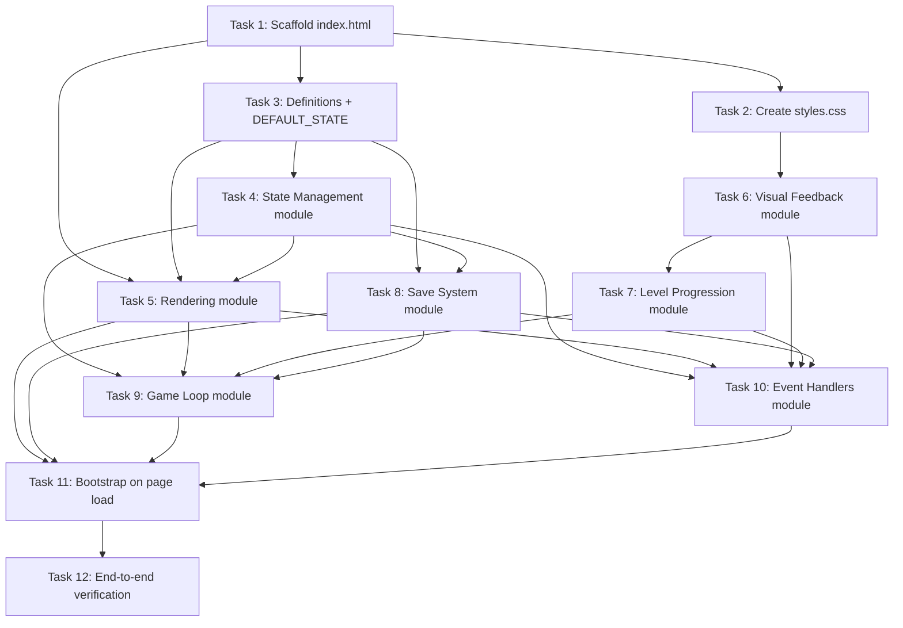

# Implementation Plan

## Cat Pet Clicker

## Overview

This implementation plan builds the Cat Pet Clicker single-page web app across three files in the workspace root: `index.html`, `styles.css`, and `game.js`. The app is a clicker/idle game where players click a cat to earn points, purchase click upgrades and auto-clickers for passive income, level up at increasing thresholds, and persist progress via `localStorage`. It runs entirely on HTML + Tailwind CDN + vanilla CSS + vanilla JS with no build step, no bundler, and no backend server — just open `index.html` directly in a browser.

The build proceeds across 12 ordered tasks following the dependency graph. The order is: scaffolding the HTML skeleton and styles, then the upgrade definitions and default state in `game.js`, then the state-management layer (mutations and cost scaling), then the save system (validation, corruption recovery, debounce, intervals), then the rendering, visual feedback, and level-progression modules, then the auto-clicker game loop, then the event handlers (cat click, purchases, reset, keyboard), then the bootstrap that wires everything together on page load, and finally an end-to-end verification pass in a browser against the requirements.

## Tasks

- [x] 1. **Scaffold index.html with page structure, Tailwind CDN, and asset links**
  - Description: Create `index.html` in the workspace root. The page must contain the full markup skeleton that all other modules will bind to: a header showing the Points_Counter, Total_Points_Earned, and Player_Level; a clickable Cat_Pet element (`id="cat-pet"`, `role="button"`, `tabindex="0"`); an Upgrade_Shop section with containers for Click_Upgrade and Auto_Clicker items; a Reset button (`id="reset-btn"`); an error message container (`id="error-message"`); and a level-up notification banner area (`id="level-up-banner"`). Load Tailwind CSS via a CDN `<script>` tag in `<head>`, link `styles.css` via `<link rel="stylesheet">`, and load `game.js` via `<script src="game.js" defer></script>`. Include empty container elements (e.g., `#click-upgrades`, `#auto-clickers`) that the rendering module will populate.
  - Requirements: Req 1, Req 2, Req 6, Req 7, Req 8
  - Acceptance Criteria:
    - `index.html` exists in the workspace root and contains semantic markup for the header, cat pet, upgrade shop, reset button, error message container, and level-up banner area.
    - Tailwind CSS is loaded via a CDN `<script>` tag in `<head>`.
    - `styles.css` is linked via `<link rel="stylesheet">`.
    - `game.js` is loaded via `<script src="game.js" defer></script>`.
    - The Cat_Pet element has `id="cat-pet"`, `role="button"`, and `tabindex="0"` for keyboard accessibility.
    - The points counter, total earned, and level each have unique ids the rendering module can target (e.g., `#points-counter`, `#total-earned`, `#player-level`).
    - The HTML file is openable directly in a browser with no build step and no server.
  - Dependencies: None
  - Status: Not Started

- [~] 2. **Create styles.css with cat styling, animations, and shop visuals**
  - Description: Create `styles.css` in the workspace root. Define the Cat_Pet base styling (large circular gradient badge with emoji placeholder). Define the `cat-pop` keyframe animation that scales the Cat_Pet to at most 115% of its original size and returns it to 100% within 200 milliseconds (`animation: cat-pop 200ms ease-out`). Define the `points-indicator` styling and a `float-up` keyframe animation that moves the floating `+N` element upward and fades it out. Define the level-up banner styling (visible/dismiss states). Define shop item styling including an affordability indicator (e.g., a disabled/styled state distinguishing items whose `currentCost > pointsCounter` from affordable ones). Use vanilla CSS only; Tailwind utilities handle the rest.
  - Requirements: Req 1, Req 3, Req 9
  - Acceptance Criteria:
    - `styles.css` exists in the workspace root and is linked from `index.html`.
    - The `cat-pop` keyframe peaks at exactly `scale(1.15)` (at most 115%) and returns to `scale(1)` over a 200ms duration.
    - A `.cat-pop` class applies the keyframe animation.
    - The `.points-indicator` class is positioned absolutely and has a `float-up` animation that translates upward and fades out.
    - A level-up banner style exists with visible and hidden states.
    - Shop item styling includes a clear visual distinction for unaffordable items (e.g., reduced opacity / disabled appearance).
  - Dependencies: Task 1
  - Status: Not Started

- [~] 3. **Implement upgrade/auto-clicker definitions and DEFAULT_STATE in game.js**
  - Description: Create `game.js` in the workspace root and implement the **Upgrade Definitions** and **Default State** modules (with comment banners). Define the `CLICK_UPGRADES` array: `sharper-claws` (baseCost 10, effectValue 1), `golden-paw` (baseCost 100, effectValue 5), `laser-pointer` (baseCost 500, effectValue 25). Define the `AUTO_CLICKERS` array: `kitten-helper` (baseCost 50, incomeRate 1), `cat-robot` (baseCost 250, incomeRate 5), `cat-empire` (baseCost 1000, incomeRate 25). Define `DEFAULT_STATE` with `pointsCounter: 0`, `clickPower: 1`, `totalPointsEarned: 0`, `playerLevel: 1`, and `clickUpgrades`/`autoClickers` maps keyed by id, each entry `{ ownedCount: 0, currentCost: <baseCost> }`. These are code constants, never persisted directly.
  - Requirements: Req 1, Req 5
  - Acceptance Criteria:
    - `game.js` exists in the workspace root and contains a clearly delimited **Upgrade Definitions** section with `CLICK_UPGRADES` and `AUTO_CLICKERS` arrays matching the specified ids, baseCosts, and effect/income values.
    - `CLICK_UPGRADES` entries have `id`, `name`, `baseCost`, `effectValue`; `AUTO_CLICKERS` entries have `id`, `name`, `baseCost`, `incomeRate`.
    - A clearly delimited **Default State** section defines `DEFAULT_STATE` with the exact starting values from the design (pointsCounter 0, clickPower 1, totalPointsEarned 0, playerLevel 1, no upgrades owned, costs at baseCost).
    - `DEFAULT_STATE` is a fresh-cloneable object (used for new games and corruption recovery) — it should not be mutated directly; callers should `structuredClone` or deep-copy it.
  - Dependencies: Task 1
  - Status: Not Started

- [~] 4. **Implement State Management module (mutations and cost scaling)**
  - Description: Implement the **State Management** module in `game.js`. Create the live `state` object (deep copy of `DEFAULT_STATE`). Implement pure/state-aware helpers: `clampToZero(value)` returning `Math.max(0, value)`; `addPoints(amount)` adding `amount` to both `pointsCounter` and `totalPointsEarned`; `deductPoints(amount)` subtracting from `pointsCounter` with `clampToZero`. Implement `purchaseClickUpgrade(id)` that checks `state.pointsCounter >= currentCost`; if affordable, deducts the cost, increases `clickPower` by the upgrade's `effectValue`, increments `ownedCount`, and sets `currentCost` to `nextClickUpgradeCost(oldCost)`; if unaffordable, leaves state unchanged. Implement `purchaseAutoClicker(id)` analogously, incrementing `ownedCount` and applying `nextAutoClickerCost(oldCost)`. Implement `nextClickUpgradeCost(currentCost)` returning `Math.round(currentCost * 1.5)`. Implement `nextAutoClickerCost(currentCost)` returning `Math.floor((currentCost * 3 + 1) / 2)` for deterministic half-up rounding.
  - Requirements: Req 1, Req 2, Req 3, Req 4
  - Acceptance Criteria:
    - `addPoints(amount)` increments both `state.pointsCounter` and `state.totalPointsEarned` by `amount`.
    - `deductPoints(amount)` sets `state.pointsCounter` to `clampToZero(state.pointsCounter - amount)`; it never produces a negative value.
    - `purchaseClickUpgrade` only mutates state when `pointsCounter >= currentCost`; otherwise the entire state is left unchanged.
    - On a successful click-upgrade purchase, `clickPower` increases by `effectValue`, `pointsCounter` decreases by the cost, `ownedCount` increments by 1, and `currentCost` becomes `Math.round(oldCost * 1.5)`.
    - On a successful auto-clicker purchase, `ownedCount` increments by 1, `pointsCounter` decreases by the cost, and `currentCost` becomes `Math.floor((oldCost * 3 + 1) / 2)`.
    - `nextAutoClickerCost` rounds halves up deterministically for positive integer inputs (verified against a reference half-up rounding for a large range).
  - Dependencies: Task 3
  - Status: Not Started

- [~] 5. **Implement Rendering module (DOM updates within 100ms)**
  - Description: Implement the **Rendering** module in `game.js`. Implement `render()` that reads `state` and synchronously updates the DOM: sets `#points-counter` to `state.pointsCounter`, `#total-earned` to `state.totalPointsEarned`, and `#player-level` to `state.playerLevel`. Implement `renderClickUpgradeShop()` and `renderAutoClickerShop()` that build/refresh each shop item showing name, current effect/income rate, current cost, owned count, and an affordability indicator (affordable vs. `currentCost > pointsCounter`). Reuse existing DOM nodes where possible to avoid full rebuild churn. `render()` is called after every state change (click, purchase, auto-tick, level-up, load).
  - Requirements: Req 2, Req 3, Req 4
  - Acceptance Criteria:
    - `render()` updates the points counter, total earned, and level text content from `state`.
    - Each Click_Upgrade item displays its name, current effect value, current cost, owned count, and an affordability indicator distinguishing unaffordable items.
    - Each Auto_Clicker item displays its name, income rate per second, current cost, and owned count, with an affordability indicator.
    - Because `render()` is called synchronously after every mutation, displayed values update within 100 milliseconds of a state change.
    - Affordability indicators update within 100 milliseconds of a points change.
  - Dependencies: Task 1, Task 3, Task 4
  - Status: Not Started

- [~] 6. **Implement Visual Feedback module (points indicator, scale, level-up queue)**
  - Description: Implement the **Visual Feedback** module in `game.js`. Implement `spawnPointsIndicator(x, y, amount)` that creates a `.points-indicator` DOM element at the click position displaying `+amount`, appends it to `document.body`, and removes it after approximately 1000 milliseconds (within the 800–1200 ms window). Implement `triggerCatScale()` that removes the `cat-pop` class, forces a reflow (`void cat.offsetWidth`), and re-adds `cat-pop` so the 200ms animation re-triggers. Implement the level-up notification queue: `notificationQueue`, `notificationShowing`, `enqueueLevelUpNotification(level)`, and `showNextNotification()`. Each notification shows a banner for exactly 2 seconds then advances the queue; multiple crossed thresholds produce one notification each, shown sequentially.
  - Requirements: Req 6, Req 9
  - Acceptance Criteria:
    - `spawnPointsIndicator` creates a floating `+N` element at the given coordinates and removes it after ~1000 ms (between 800 and 1200 ms).
    - `triggerCatScale` reliably re-triggers the `cat-pop` animation on repeated rapid clicks (re-add class after reflow).
    - The level-up notification queue shows one banner per crossed threshold, each remaining visible for exactly 2 seconds.
    - Notifications are shown sequentially (not overlapping) so each has an unambiguous 2-second duration.
  - Dependencies: Task 2
  - Status: Not Started

- [~] 7. **Implement Player Level Progression module**
  - Description: Implement the **Player Level Progression** module in `game.js`. Implement `nextLevelThreshold(level)` returning `100 * (level + 1) * (level + 1)` (the threshold to advance from `level` to `level+1`; equivalently the threshold for Player_Level N is `100 * N^2`). Implement `checkLevelUp()` that loops while `state.totalPointsEarned >= nextLevelThreshold(state.playerLevel)`, incrementing `state.playerLevel` and counting crossed thresholds; then enqueues one level-up notification per crossed threshold via `enqueueLevelUpNotification`, using the correct level numbers. This satisfies the multi-threshold case (e.g., a single points addition crossing several levels increments by that count and queues that many notifications).
  - Requirements: Req 6
  - Acceptance Criteria:
    - `nextLevelThreshold(L)` returns `100 * (L+1)^2` (so level 2 threshold = 400, level 3 = 900, level 4 = 1600, level 5 = 2500).
    - When `totalPointsEarned` reaches or exceeds the next threshold, `checkLevelUp` increments `playerLevel` by 1 and enqueues one level-up notification.
    - When a single points addition crosses multiple thresholds, `playerLevel` increments by the number of crossed thresholds and one notification is enqueued per crossed threshold (with correct level numbers).
    - `playerLevel` never decreases during a session.
  - Dependencies: Task 6
  - Status: Not Started

- [~] 8. **Implement Save System module (save, load, validation, corruption, intervals)**
  - Description: Implement the **Save System** module in `game.js`. Define `SAVE_KEY = "cat-pet-clicker-save"`. Implement `saveState()` writing `JSON.stringify(state)` to `localStorage` under `SAVE_KEY`, wrapped in try/catch. Implement `loadState()` that reads the key: if `null`, returns a deep copy of `DEFAULT_STATE` (no save); otherwise parses JSON inside try/catch, validates with `isValidGameState`, and calls `mergeWithDefaults` to fill missing upgrade entries; on any parse/validation error, calls `showErrorMessage(...)` and returns a deep copy of `DEFAULT_STATE`. Implement `isValidGameState(obj)` validating: `pointsCounter` (finite, ≥0), `clickPower` (finite, ≥1), `totalPointsEarned` (finite, ≥0), `playerLevel` (finite, ≥1); `clickUpgrades`/`autoClickers` are objects with keys matching known ids, each `{ ownedCount: non-negative integer, currentCost: positive number }`; unknown/extra/missing fields or wrong types fail validation. Implement `scheduleSave()` with a debounce timer (setTimeout saveState, 500 ms) so saves occur within 1 second of a change. Start a periodic `setInterval(saveState, 10000)` (10-second auto-save). Add a `beforeunload` listener calling `saveState()` synchronously. Implement `showErrorMessage(msg)` to display a dismissible error banner in `#error-message`.
  - Requirements: Req 5
  - Acceptance Criteria:
    - `saveState` writes JSON to `localStorage` under key `cat-pet-clicker-save`.
    - `loadState` restores `pointsCounter`, `clickPower`, `totalPointsEarned`, `clickUpgrades`, `autoClickers`, and `playerLevel` from a valid save.
    - When no save exists, `loadState` returns `DEFAULT_STATE` (level 1, points 0, clickPower 1, no upgrades).
    - When the save is malformed JSON or fails schema validation, `loadState` discards it, returns `DEFAULT_STATE`, and displays an error message indicating the saved data could not be loaded.
    - `isValidGameState` rejects missing/extra/wrong-type fields and out-of-range values; accepts valid states.
    - `scheduleSave` triggers a save within 1 second of any state change (debounced at 500 ms).
    - A periodic save runs every 10 seconds while the page is open.
    - `saveState` runs synchronously on `beforeunload`.
    - `localStorage` access is wrapped in try/catch so private-browsing/disabled-storage does not crash the game.
    - A save-then-load-then-save-then-load cycle produces a state equivalent to the first load (idempotent load; `currentCost` persisted directly preserves rounding).
  - Dependencies: Task 3, Task 4
  - Status: Not Started

- [~] 9. **Implement auto-clicker Game Loop module**
  - Description: Implement the **Game Loop** module in `game.js`. Define `AUTO_TICK_MS = 1000`. Implement `totalAutoIncome()` returning the sum across all `AUTO_CLICKERS` of `def.incomeRate * ownedCount`. Implement `autoTick()` that computes total income, calls `addPoints(income)` (updating both `pointsCounter` and `totalPointsEarned`), calls `checkLevelUp()`, calls `render()`, and calls `scheduleSave()`. Start the interval with `setInterval(autoTick, AUTO_TICK_MS)` during bootstrap; the 1000 ms interval keeps consecutive additions between 900 and 1100 ms in practice.
  - Requirements: Req 4
  - Acceptance Criteria:
    - `totalAutoIncome` equals `Σ (def.incomeRate × ownedCount)` across all Auto_Clicker types.
    - Each `autoTick` adds the same total income to both `pointsCounter` and `totalPointsEarned` (neither is incremented independently).
    - The auto-tick interval runs at ~1000 ms (within the 900–1100 ms tolerance).
    - Each tick checks for level-ups and renders, then schedules a debounced save.
  - Dependencies: Task 4, Task 5, Task 7, Task 8
  - Status: Not Started

- [~] 10. **Implement Event Handlers module (cat click, purchases, reset, keyboard)**
  - Description: Implement the **Event Handlers** module in `game.js`. Attach a click handler to `#cat-pet` that: calls `addPoints(state.clickPower)`, calls `spawnPointsIndicator(event.clientX, event.clientY, state.clickPower)`, calls `triggerCatScale()`, calls `checkLevelUp()`, calls `render()`, and calls `scheduleSave()`. Add keyboard activation (Enter/Space) for the cat pet to mirror the click. Attach click handlers to each shop item (Click_Upgrade and Auto_Clicker) that call `purchaseClickUpgrade`/`purchaseAutoClicker` with the item id, then `render()` and `scheduleSave()`; the rendering module should bind these handlers as it builds items. Implement the Reset button: on click, show a confirmation dialog (confirm/cancel options); on confirm, delete the `localStorage` key (`localStorage.removeItem(SAVE_KEY)`), replace `state` with a deep copy of `DEFAULT_STATE`, `render()`, and clear any pending saves; on cancel, leave everything unchanged. Wire `#error-message` dismiss interaction.
  - Requirements: Req 1, Req 3, Req 4, Req 7, Req 9
  - Acceptance Criteria:
    - Clicking the Cat_Pet adds `clickPower` to `pointsCounter` and `totalPointsEarned`, spawns a `+clickPower` indicator at the click position, and triggers the scale animation.
    - Keyboard activation (Enter/Space) on the cat pet behaves identically to a mouse click.
    - Clicking an affordable Click_Upgrade deducts cost and increases `clickPower`; clicking an unaffordable one leaves state unchanged.
    - Clicking an affordable Auto_Clicker deducts cost and increments `ownedCount`; clicking an unaffordable one leaves state unchanged.
    - Clicking the Reset button shows a confirmation dialog with confirm and cancel options.
    - Confirming the reset deletes the `localStorage` save and resets state to defaults; canceling leaves state unchanged.
    - After every handled interaction, `render()` is called and a debounced save is scheduled.
  - Dependencies: Task 4, Task 5, Task 6, Task 7, Task 8
  - Status: Not Started

- [~] 11. **Implement bootstrap on page load**
  - Description: Implement the **Bootstrap** module in `game.js` wired to `DOMContentLoaded`/`load`. On load: verify that critical DOM elements exist (log a clear error if any required id is missing rather than silently failing); call `loadState()` to restore the game (or fall back to `DEFAULT_STATE`); assign the result to the live `state`; call `render()`; start the auto-tick `setInterval`; start the 10-second periodic save `setInterval`; and register the `beforeunload` save listener. This ties together state loading, rendering, the game loop, and the save system so the app is functional immediately on open.
  - Requirements: Req 5
  - Acceptance Criteria:
    - On page load, `loadState()` is called and its result populates the live `state`.
    - `render()` is called after load so the page reflects the restored (or default) state immediately.
    - The auto-clicker interval and the 10-second periodic save interval are started on load.
    - The `beforeunload` save listener is registered on load.
    - If a required DOM element is missing, a clear error is logged instead of a silent `TypeError` failure.
    - The app is fully functional immediately after opening `index.html` with no manual intervention.
  - Dependencies: Task 5, Task 8, Task 9, Task 10
  - Status: Not Started

- [~] 12. **End-to-end verification in a browser (no build, no server)**
  - Description: Open `index.html` directly in a browser (file protocol, no build step, no server) and verify the whole application works end to end against the requirements. Confirm: clicking the cat earns points and shows the floating indicator + scale animation; the points counter, total earned, and level display update; Click_Upgrades and Auto_Clickers show name/effect/cost/owned and affordability; purchases deduct points and scale costs; auto-clickers add passive income each second; levels increase at the `100 * N^2` thresholds with 2-second level-up banners (including multi-threshold jumps); progress persists across reload and is restored; corrupt/missing save recovers to defaults with an error message; the reset button confirms before deleting and resetting; and the page runs entirely on the specified stack (HTML + Tailwind CDN + vanilla CSS + vanilla JS, no framework, no bundler).
  - Requirements: Req 1, Req 2, Req 3, Req 4, Req 5, Req 6, Req 7, Req 8, Req 9
  - Acceptance Criteria:
    - The app loads by opening `index.html` directly with no compilation, transpilation, bundling, or backend server.
    - Cat clicking adds points, spawns the indicator at the click position, and plays the scale animation; total earned updates; levels trigger at the correct thresholds with 2-second banners.
    - Shop items display all required fields and affordability indicators; purchases work and scale costs by 1.5x (click upgrades via `Math.round`, auto-clickers via half-up).
    - Auto-clickers add passive income once per second to both points and total earned.
    - Progress persists across reload and restores correctly; a corrupted/malformed save falls back to defaults with an error message.
    - Reset shows a confirmation dialog; confirming deletes the save and resets to defaults; canceling leaves state unchanged.
    - All nine requirements are demonstrably satisfied in a single browser session.
  - Dependencies: Task 11
  - Status: Not Started

## Task Dependency Graph

Tasks are grouped into waves where each wave is a set of tasks that can run in parallel (no inter-dependencies among tasks in the same wave). The waves below are derived from the task dependencies, and the explicit dependency map is included for reference.

```json
{
  "waves": [
    { "wave": 1, "tasks": [1] },
    { "wave": 2, "tasks": [2, 3] },
    { "wave": 3, "tasks": [4] },
    { "wave": 4, "tasks": [5, 6, 8] },
    { "wave": 5, "tasks": [7] },
    { "wave": 6, "tasks": [9, 10] },
    { "wave": 7, "tasks": [11] },
    { "wave": 8, "tasks": [12] }
  ],
  "dependencies": {
    "1": [],
    "2": [1],
    "3": [1],
    "4": [3],
    "5": [1, 3, 4],
    "6": [2],
    "7": [6],
    "8": [3, 4],
    "9": [4, 5, 7, 8],
    "10": [4, 5, 6, 7, 8],
    "11": [5, 8, 9, 10],
    "12": [11]
  }
}
```

The mermaid diagram below renders the same dependency relationships for visual reference:



## Notes

All tasks target vanilla JS/HTML/CSS with no build step. Run Task 12 by opening `index.html` directly in a browser. Adjust the placeholder game-balance values (upgrade base costs, effects, income rates) in `game.js` during playtesting.
